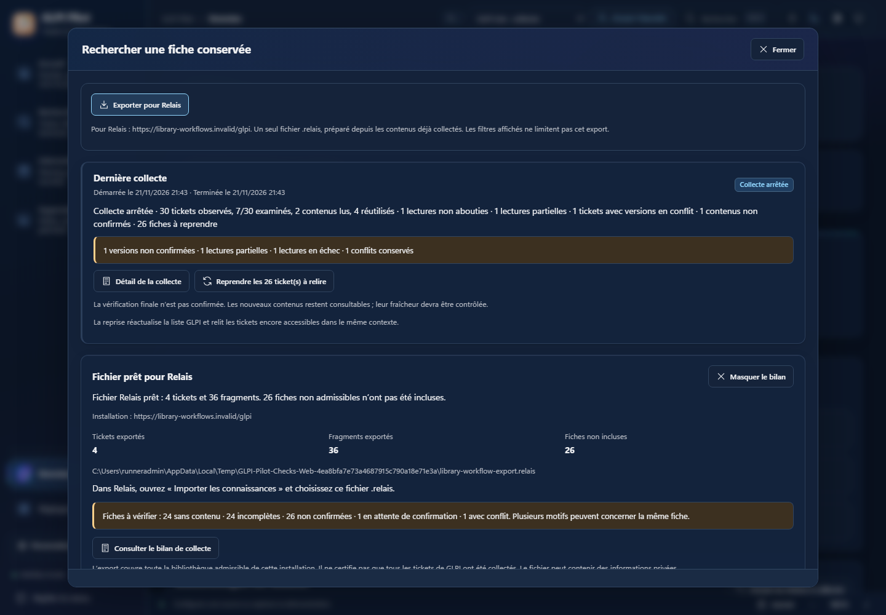

# GLPI Pilot 4.0.18 — qualification et publication vérifiées

La [release v4.0.18](https://github.com/M4D135/GLPI-Pilot/releases/tag/v4.0.18) est publiée le **21 novembre 2026 à 23:16:01 (Europe/Paris)**, soit **22:16:01 UTC**. La qualification complète, les deux sélecteurs de l’original et les contrôles après publication ont réussi.

Cette version ajoute **Bibliothèque → Exporter pour Relais** : un seul fichier `.relais`, préparé depuis les contenus locaux admissibles de l’installation. Les [notes de version](RELEASE-4.0.18.md) et le [contrat d’export](Format-export-Relais.md) décrivent le parcours et ses limites.

## Identité de la livraison

| Élément | Identité établie |
| --- | --- |
| Version | `4.0.18` |
| Commit du code, des exécutables et du tag `v4.0.18` | `4c374fe83c33c1be939dc02d5ffaa70fc928aae4` |
| Arbre Git | `d95c2260d98e612078188e0ece444c28a7805e93` |
| Qualification | [Run 44952856008](https://github.com/M4D135/GLPI-Pilot/actions/runs/44952856008), exécution nº **108**, tentative **1** ; **16/16 jobs réussis**, conclusion **success** |
| Original GitHub Actions | [Artefact 14726861089](https://github.com/M4D135/GLPI-Pilot/actions/runs/44952856008/artifacts/14726861089) |
| Archive originale | `GLPI-Pilot_4.0.18_PROD-LIGHT_Windows-x64.zip` |
| Taille | **139 171 455 octets** |
| SHA-256 du ZIP original | `7a76ba3ecf687f25b44173f208fc21694c195cd6104ce730852a81a5be62a49a` |
| Distribution | `PROD-LIGHT`, cible `win-x64`, runtime WebView2 installé sur Windows |

Le reçu officiel `GLPI_CI_ORIGINAL`, les métadonnées de l’artefact et les octets du ZIP téléchargé concordent sur le dépôt, le run, la tentative, le commit, la taille et l’empreinte. Les deux modes du sélecteur canonique ont validé ce même original après la réussite complète du run.

## Comportements d’export couverts

- **Un fichier autonome.** L’export crée une nouvelle base SQLite `.relais` depuis une transaction source en lecture seule. Les écritures validées encore présentes dans le WAL sont incluses. L’utilisateur n’a pas à copier la base ou ses journaux, à fermer Pilot pour exporter, ni à installer Node.js sur son poste.
- **Périmètre explicite.** Le fichier couvre toute la bibliothèque locale admissible de l’installation, indépendamment de la recherche, des filtres et de la pagination. Il ne déclenche aucune collecte GLPI et ne certifie pas que tous les tickets du portail ont été recueillis.
- **Qualité conservée.** Seuls les fragments sélectionnés, complets, confirmés, sans confirmation en attente ni conflit et non vides sont exportés. Les références exactes sont conservées. Les motifs d’exclusion portent sur les tickets source, peuvent se recouper et restent distincts du nombre de fragments exportés.
- **Publication locale maîtrisée.** Zéro contenu admissible ne produit aucun fichier. Une annulation ou une limite dépassée ne publie pas de fichier partiel. La destination doit être nouvelle ; les fichiers existants sont conservés. La préparation et la vérification précèdent la publication finale du fichier fermé.
- **Confidentialité inchangée.** Les profils, identifiants de connexion, sessions, archives et journaux opérationnels ne sont pas copiés. Les textes métier ne sont pas anonymisés automatiquement ; leurs indications privées ou inconnues restent inchangées. Le contrat ne réplique pas les ACL GLPI.

Le fichier vise le parcours d’import de **Relais 0.6.3**, qui contrôle son manifeste et recalcule son contenu avant l’import. Les limites de Pilot restent **200 000 fragments**, **256 Mio de JSON normalisé**, **2 Mio par corps** et **512 Mio de fichier**. Un dépassement ne sélectionne pas silencieusement un sous-ensemble.

## Résultats observés sur ce run

Les suites se recouvrent et peuvent être réexécutées dans plusieurs jobs. Les compteurs suivants ne doivent pas être additionnés. La conclusion globale et chaque job sont vérifiés séparément.

| Contrôle | Résultat établi | Preuve conservée |
| --- | --- | --- |
| Parcours de bibliothèque, édition Standard | **17/17** | Journal officiel `library-workflows-standard.log` ; [artefact Standard](https://github.com/M4D135/GLPI-Pilot/actions/runs/44952856008/artifacts/14726208097) |
| Même parcours, édition Admin | **17/17** | Journal officiel `library-workflows-admin.log` |
| Isolation et arrêt du runtime, job dédié | **233/233**, dont `CancelFinal` | Journal officiel `runtime-isolation-job.log` |
| Packaging du runtime | **14/14** | Journal officiel `windows-job.log` |
| Hôtes Windows réels Standard et Admin | **72/72** | Journal officiel `windows-job.log` |
| Mise à jour et retour arrière | **4/4** | Journal officiel `windows-job.log` |
| Export Relais Core | **12/12** | [Job C# et navigateur](https://github.com/M4D135/GLPI-Pilot/actions/runs/44952856008/job/136994464886) |
| Intégration complète WebView / runtime | **139/139 / 233/233** | [Job interfaces complètes](https://github.com/M4D135/GLPI-Pilot/actions/runs/44952856008/job/136994464862) |
| Acquisition de bibliothèque | **60/60** | [Job C# et navigateur](https://github.com/M4D135/GLPI-Pilot/actions/runs/44952856008/job/136994464886) |
| Qualification globale | **16/16 jobs réussis** | [Run complet](https://github.com/M4D135/GLPI-Pilot/actions/runs/44952856008) |

Les parcours de bibliothèque vérifient un bouton d’export unique et actif dans le panneau intégré, même lorsque la recherche affichée ne retourne aucun ticket. Ils ouvrent ensuite le vrai fichier SQLite produit, contrôlent son installation et les compteurs du manifeste, puis annulent un second dialogue d’enregistrement en vérifiant que le fichier précédent est conservé. Aucun appel de collecte GLPI supplémentaire n’est déclenché par l’export.

Le scénario `CancelFinal` attend désormais les jalons réels de sa préparation : index initial, requête de chaque identifiant attendu, puis index final. Chaque transition conserve son plafond de quinze secondes, et le scénario entier reste borné à quarante-cinq secondes. Une fin anticipée de la tâche propage son erreur ; un échec d’attente annule puis termine proprement la tâche possédée. Les assertions sur les trois corps lus mais non confirmés, l’absence de résolution admissible, la fermeture de la cible et la reprise restent conservées. Le résultat **233/233** est confirmé dans le job dédié et dans le job des interfaces complètes ; `CancelFinal` passe dans les deux exécutions.

### Contrôle visuel du parcours

La capture synthétique `library-workflows-relais-export-dark.png` montre le bouton **Exporter pour Relais** dans le panneau intégré et un bilan **Fichier prêt pour Relais** : **4 tickets**, **36 fragments**, **26 fiches non incluses**, avec l’installation et l’instruction de choisir le fichier dans Relais. Le résumé de collecte et le bilan d’export sont distincts ; aucun texte `null` parasite n’est visible dans le résumé.

Le bas du panneau est partiellement hors du cadrage. Cette capture ne prouve donc pas la visibilité de son contenu intégral ; les assertions navigateur vérifient séparément les éléments du parcours et les compteurs.

| Preuve visuelle | Taille | SHA-256 vérifié |
| --- | ---: | --- |
| Artefact `library-compatibility-false-44952856008-1`, identifiant **14726208097** | **1 122 813 octets** | `dd9a9f57458ef2637036213c11d03fb7616367fb014b4bff9ff7b67ebd2809a9` |
| Capture `library-workflows-relais-export-dark.png` | **218 167 octets** | `2e6b93e5f497fc5d96c93d5f7dcb3e49a93fd8dece38bfc936e09cf48f09e5b0` |

L’image conservée est identique octet par octet à son entrée dans l’artefact dont les métadonnées désignent le commit et le run ci-dessus. Les tickets et le portail de cette capture sont fictifs.

## Inspection du ZIP et des ressources PE

Le vérificateur canonique a validé **384 fichiers manifestés**, plus `wad/SHA256SUMS.txt`, soit **385 fichiers**. La racine contient les deux exécutables et `wad/`. La version, le commit, la distribution et les empreintes déclarées concordent. Le pack PROD-LIGHT déclare `evergreen-installed` et n’embarque ni runtime WebView2 fixe ni export de sources. Le contrôle d’inventaire n’a détecté aucun des chemins de données opérationnelles interdits par le vérificateur ; il ne constitue pas une analyse de secrets de tous les octets.

Les deux exécutables ont été lus directement en mémoire depuis le ZIP, sans extraction sur disque ni exécution. Le lecteur a parcouru les en-têtes PE et les vraies ressources `RT_VERSION`, `VS_FIXEDFILEINFO` et `StringFileInfo`.

| Exécutable | Taille | Architecture et version de fichier | SHA-256 |
| --- | ---: | --- | --- |
| `GLPI-Pilot.exe` | **54 003 727 octets** | AMD64 `0x8664`, PE32+ ; **4.0.18.0** | `710deb83fd9728e8bce4abed6957ea3ebad02ae29b723e6d6e03e9f9412362c6` |
| `GLPI-Pilot-Admin.exe` | **54 003 803 octets** | AMD64 `0x8664`, PE32+ ; **4.0.18.0** | `2bced62b60b28fa2a330795fa39a103c69e037ba532890b152a26bca72b401dd` |

Les deux chaînes `ProductVersion` valent **`4.0.18+4c374fe83c33c1be939dc02d5ffaa70fc928aae4`**. Les empreintes sont distinctes et correspondent au manifeste ainsi qu’à `wad/version.json`.

Les rapports `pack-verification.json`, `pe-verification.json` et `screenshot-provenance.json` sont des contrôles conservés pendant la préparation, hors du dépôt. Ils ne sont pas présentés comme des artefacts publics de qualification. Le SHA-256 du rapport PE est `c9486374084423b0356ab4d45c7fb854e9ac46cdbf82e14f5ebe49d96640835e`.

La comparaison avec les blobs du commit exact couvre **134/134 fichiers web** (10 identiques octet par octet, 124 avec seulement CRLF/LF) et **112/112 documents** (2 identiques, 110 avec seulement CRLF/LF). Les documents correspondent aux 111 fichiers suivis sous `docs/`, plus `README.md` copié en `LISEZ-MOI.md` par `build.ps1`. Aucun manquant, supplément ou écart réel ; la seule normalisation admise est CRLF vers LF sur du texte UTF-8. Le module `library.js` du pack est bien celui du bouton visible et du résumé corrigé. SHA-256 du rapport de comparaison : `a6f14b70c54d3f787c18f5d48928e49edb369206491844530408a5c7dccbbbc4`.

## Publication vérifiée

La publication a utilisé le run complet et son original inspecté, sans recompilation ni recompression. Les vérifications finales sont les suivantes.

| Vérification finale | Résultat établi |
| --- | --- |
| Conclusion complète, nombre de jobs et heure UTC de fin | **16/16 jobs réussis**, conclusion `success` ; 21 novembre 2026 à **22:13:48 UTC** |
| Sélecteurs de l’original : reçu officiel et artefact du même run/tentative | `select-verified-release.py --stored` et mode normal : sorties **0** ; artefact **14726861089** sélectionné |
| Run de publication, tentative et conclusion | [Run 44955810171](https://github.com/M4D135/GLPI-Pilot/actions/runs/44955810171), exécution nº **29**, tentative **1**, conclusion `success` |
| Identifiant de release, état brouillon/préversion et URL | **454022125**, [v4.0.18](https://github.com/M4D135/GLPI-Pilot/releases/tag/v4.0.18), ni brouillon ni préversion |
| Date et heure de publication, UTC et heure locale précisée | 21 novembre 2026 à **23:16:01 (Europe/Paris)**, soit **22:16:01 UTC** |
| Commit vérifié du tag `v4.0.18` | `4c374fe83c33c1be939dc02d5ffaa70fc928aae4` |
| Artefact des preuves après publication | [Artefact 14726524475](https://github.com/M4D135/GLPI-Pilot/actions/runs/44955810171/artifacts/14726524475), **29 509 octets**, SHA-256 `b75f92af47abc1c0faba7b5a1a297b25baa816f29d2c5c7653e644328eff4734` |
| Taille et SHA-256 publics, comparaison des octets avec l’original | ZIP **139 171 455 octets**, SHA-256 `7a76ba3ecf687f25b44173f208fc21694c195cd6104ce730852a81a5be62a49a` ; ZIP et `SHA256SUMS.txt` **identiques octet par octet** aux originaux |

Les deux fichiers publics ont été retéléchargés indépendamment du workflow. Le [ZIP](https://github.com/M4D135/GLPI-Pilot/releases/download/v4.0.18/GLPI-Pilot_4.0.18_PROD-LIGHT_Windows-x64.zip) et [SHA256SUMS.txt](https://github.com/M4D135/GLPI-Pilot/releases/download/v4.0.18/SHA256SUMS.txt) sont identiques octet par octet aux fichiers inspectés. Le fichier d’empreintes mesure **111 octets**, SHA-256 `bb662ce5c7aa67fd23ae80ffac843306470da2c83539d9aa843ee1746e97427f`. Le vérificateur canonique exécuté sur le téléchargement public valide de nouveau les **384 fichiers manifestés**, les versions et le commit. Les rapports candidate-archives et published-archives du workflow correspondent aussi à l’inspection locale.

## Conservation des données et limites

Pour mettre à jour Pilot, fermer les deux lanceurs, sauvegarder le profil et le dossier complet de bibliothèque avec ses journaux SQLite, puis extraire le pack dans un nouveau dossier d’application en conservant le compte Windows et les réglages habituels. Cette procédure de mise à jour est distincte de l’export `.relais`, qui s’utilise depuis Pilot ouvert.

Commencer par essayer l’export de la bibliothèque existante. En cas de contenu non admissible, consulter les motifs avant de prévoir une reprise ciblée. La mise à jour ne confirme pas rétroactivement les corps et ne lance pas une nouvelle collecte complète. Les essais utilisent des données synthétiques ; ils ne constituent ni une collecte sur le portail réel de l’entreprise ni un diagnostic de sa bibliothèque. La mise à jour du serveur Relais se réalise séparément en conservant ses comptes et son stockage.

Ce reçu et la capture sont ajoutés après construction. Le pack conserve les documents de son commit qualifié ; son tag et ses octets restent inchangés.
